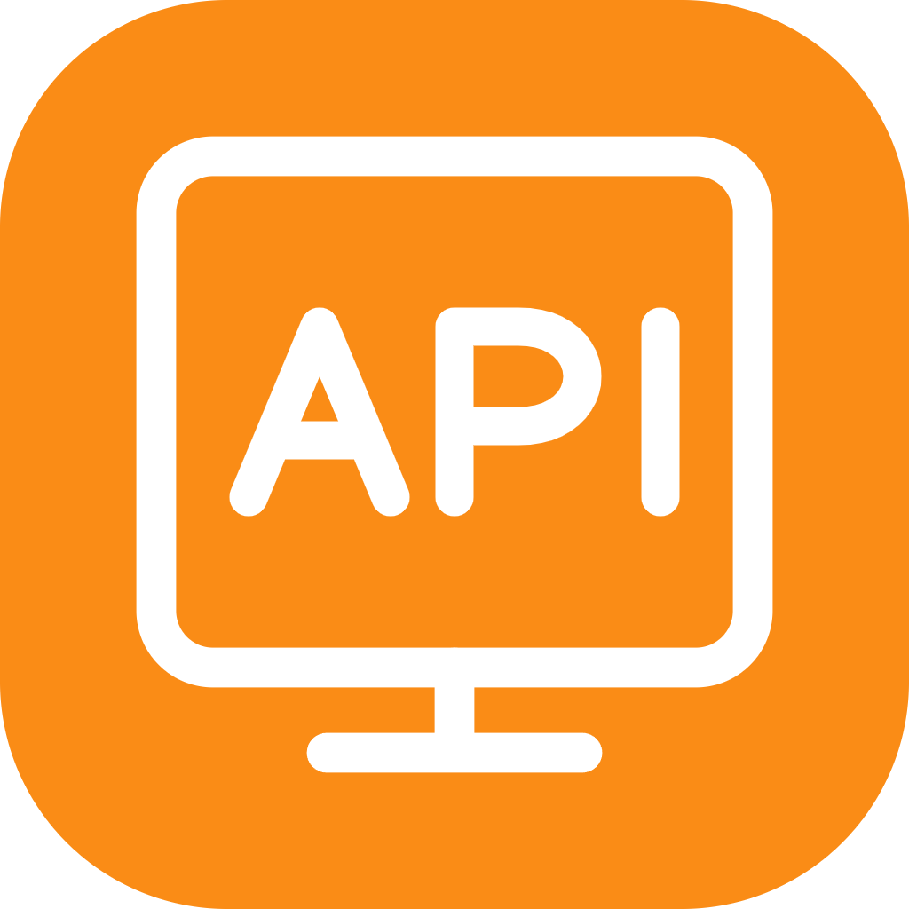

<p align="center">
  <a href="https://github.com/Tiane-ira/my-post">
    
  </a>
</p>

<h1 align="center">mypost</h1>

<p align="center">
  <strong>专为开发者打造的纯本地、高颜值、轻量级 API 研发与调试工作台</strong><br>
  <em>Postman / Apifox 的纯本地离线替代方案 · 零登录 · 零外网 · 零数据上报 · 100% 本地明文存储</em>
</p>

<p align="center">
  <a href="README.md">简体中文</a> | <a href="README_EN.md">English</a>
</p>

<p align="center">
  <a href="https://github.com/Tiane-ira/my-post/releases"></a>
  <a href="https://github.com/Tiane-ira/my-post/blob/main/LICENSE"></a>
  
  
  
  <a href="https://github.com/Tiane-ira/my-post/stargazers"></a>
  <a href="https://github.com/Tiane-ira/my-post/network/members"></a>
  <a href="https://github.com/Tiane-ira/my-post/issues"></a>
</p>

---

## 💡 为什么选择 mypost？

现有的 API 调试工具普遍转向**强制云端同步、强制登录账号、团队订阅收费**的重型商业化模式：
- ❌ **强制联网登录**：无网、弱网或涉密机房环境下根本无法打开或正常使用；
- ❌ **敏感数据风险**：内部私有接口地址、生产环境 Token、Authorization 与 Cookie 被悄然同步到云端数据库，存在合规与泄漏隐患；
- ❌ **软件庞大臃肿**：频繁弹窗推广商业团队版，启动缓慢，消耗大量内存；
- ❌ **私有格式锁定**：历史接口导出困难，难以无缝接入个人 Git 进行版本化管理。

> **mypost 的初心与承诺：**  
> 一款**彻底属于个人、完全运行在本地磁盘**的高性能 API 调试工作台。  
> **打开即用、无需登录、永不上传数据**，项目与接口数据全量以**标准人类可读的明文 JSON 文件**存储。

---

## ⚡ 核心优势与竞品对比

| 核心维度 | 🚀 **mypost** | **Postman** | **Apifox** | **Bruno** |
| :--- | :---: | :---: | :---: | :---: |
| **注册登录要求** | 🟢 **无需登录，开箱即用** | 🔴 强制云端登录 | 🔴 强制账号登录 | 🟢 无需登录 |
| **数据存储形态** | 📂 **标准明文 JSON 文件** | ☁️ 闭源云端数据库 | ☁️ 闭源云端数据库 | 📝 自定义 Bru 格式 |
| **Git 协作与版本回溯** | 🟢 **原生兼容（文件夹即项目）** | 🟡 仅付费团队版支持 | 🟡 需云端团队协作 | 🟢 Git 友好 |
| **隐私与离线断网** | 🔒 **100% 离线，零数据上报** | 🔴 频繁遥测与云同步 | 🔴 强制联网同步 | 🔒 离线可用 |
| **HTTP / HTTPS 深度调试** | 🟢 支持（带底层实际请求抓包） | 🟢 支持 | 🟢 支持 | 🟢 支持 |
| **SSE 流式长连接 (AI大模型)** | 🟢 **卡片/原始双视图 + 环形防卡死** | 🟡 基础支持 | 🟡 基础支持 | 🟡 基础支持 |
| **WebSocket 全双工工作台** | 🟢 **拖拽分屏 + 自动心跳 + 连续帧序号** | 🟡 简易调试窗口 | 🟡 基础支持 | 🟡 需插件/支持弱 |
| **OpenAPI / Swagger 导入** | 🟢 **本地全解析（含 $ref 自动解包）** | 🟢 支持 | 🟢 支持 | 🟡 部分支持 |
| **国产系统与 Linux 深度适配** | 🟢 **银河麒麟/统信/Ubuntu 零黑屏** | 🔴 依赖库常冲突报错 | 🟡 闭源打包 | 🟡 通用 Linux |
| **费用模式** | 🆓 **100% 开源免费 (MIT)** | 💰 昂贵席位订阅 | 💰 商业化团队版 | 🟡 双轨制（部分高级功能收费） |

---

## 📥 立即下载与使用 (Downloads)

所有预编译发行版本均通过 GitHub Actions 自动化编译打包，安全可靠：

👉 **[前往 Releases 页面获取最新版下载](https://github.com/Tiane-ira/my-post/releases/latest)**

| 操作系统 | 推荐安装包 | 说明 |
| :--- | :--- | :--- |
| **Windows** | `mypost-Setup-x.x.x-win-x64.exe`<br>`mypost-x.x.x-win-x64-portable.exe` | 推荐标准安装包；另提供免安装即点即用绿色便携版 |
| **macOS** | `mypost-x.x.x-mac-arm64.dmg`<br>`mypost-x.x.x-mac-arm64.zip` | 深度适配 Apple Silicon (M1/M2/M3/M4 系列芯片) |
| **Linux** | `mypost-x.x.x-linux-x64.AppImage`<br>`mypost_x.x.x_amd64.deb` | 免黑屏机制，深度兼容 Ubuntu、Debian 以及**国产操作系统（银河麒麟 Kylin V10、统信 UOS）** |

---

## 🌟 核心功能一览

### 1. 📂 纯本地透明 JSON 数据管理
- **透明的目录结构**：项目数据全量以标准 JSON 保存在本地磁盘，绝不使用任何私有加密数据库：
  ```
  ~/.mypost/projects/<project_id>/   （或你指定的任意目录）
  ├── project.json                   # 项目元数据与基本信息
  ├── tree.json                      # 目录树与接口层级关系
  ├── envs.json                      # 环境变量组与全局变量列表
  └── apis/                          # 接口明文独立文件
      ├── api-1729178000000.json     # 完整请求参数、Headers、Body、Auth 与断言
      └── api-1729178000001.json
  ```
- **Git 极度友好**：直接将项目文件夹初始化为 Git 仓库或软链接至你的源码仓库，团队成员通过 Git pull/push 即可共享接口文档，无需付费购买云端协作套件。
- **极简备份与迁移**：随拷随走，换电脑只需拷贝文件夹即可完全无损恢复。

### 2. 🚀 HTTP / HTTPS 接口深度调试
- **常用与扩展方法**：完整覆盖 GET、POST、PUT、DELETE、PATCH、OPTIONS、HEAD 等。
- **全能请求体配置**：
  - `none`、`form-data`（支持文件上传与多参数）、`x-www-form-urlencoded`
  - `json`（内置语法高亮与折叠校验）、`raw`（XML、纯文本）、`binary`（二进制流文件）
- **主流鉴权原生覆盖**：Bearer Token、Basic Auth、API Key（自由注入 Header 或 Query）。
- **脚本与自动化测试**：内置安全沙箱，支持前置预处理脚本（Pre-request Script）与后置测试断言（Tests），快速提取 Token、动态赋值或断言响应字段。
- **底层“实际请求”报文查看**：清晰还原经过变量计算、重定向与网络引擎补齐后**真正发往服务器的底层报文**，接口排障快人一步。

### 3. 🌊 SSE (Server-Sent Events) 流式推送调试
*专为 ChatGPT、Claude、DeepSeek 等大语言模型（LLM）流式接口调优打造*
- **卡片 / 原始报文双视图**：
  - **美化卡片视图**：实时解析 JSON 数据包、事件类型（`event`）高亮与筛选、折叠展开；
  - **标准报文视图**：逐行呈现网络原始 `event:` / `data:` / `id:` 帧。
- **环形缓冲区流控防卡死**：针对高频推送数据流内置 FIFO 淘汰机制与微批次帧率调度，即便持续接收上万条事件推送，界面依然丝滑不卡顿。
- **后台持续监听**：切换工作标签页不会中断已建立的流式会话，只有显式关闭标签页才会断开连接。

### 4. 🔌 WebSocket 全双工通信工作台
- **广泛协议兼容**：支持 `ws://` 与 `wss://` 加密协议，支持自定义 Headers 与子协议（`Sec-WebSocket-Protocol`）。
- **拖拽式自适应分屏**：握手配置区与消息互动区支持上下自由拖拽分割高度，双击重置比例，完美匹配各类宽窄屏幕。
- **自动化心跳保活 (Heartbeat Ping)**：支持自定义心跳包内容与发送周期，配置持久化记忆。
- **双向数据流监控与搜索**：收发消息采用不同色彩标识，支持按方向筛选、实时关键词高亮搜索与快速格式化。
- **微批次合并与连续序号**：配备连续帧序号（`#seq`）跟踪机制，即使早期历史被修剪，累计统计依然精准无误。

### 5. 🧩 智能变量占位符系统 (`{{variable}}`)
- **全域可用**：在 URL 地址、Headers、Query 参数、Auth 鉴权、Body 以及长连接地址中随处调用。
- **智能联想气泡**：输入 `{{` 即可触发动态补全浮层，支持键盘上下切换选中。
- **悬停即时预览**：鼠标悬停在变量胶囊上方，即时显示当前求值结果及其来源（环境变量组 / 全局变量）。
- **多层嵌套解析**：支持变量之间层级引用计算（如 `{{baseUrl}}` 引用 `{{domain}}:{{port}}`）。

### 6. 🔄 强大的导入、导出与文档分享
- **全能导入**：
  - 支持直接粘贴 **cURL** 命令行一键生成接口；
  - 支持导入 **Postman Collection v2/v2.1** 集合；
  - 支持导入 **Swagger 2.0** 与 **OpenAPI 3.0/3.1**（支持 JSON / YAML 格式，内置 `$ref` 架构自动解包展开）。
- **优雅导出与分享**：
  - 支持将接口或文件夹一键导出为标准的 **Markdown** 技术文档；
  - 支持生成离线接口分享包，方便团队成员或前端开发独立阅读调试。

---

## ⌨️ 常用快捷键

| 快捷键 | 功能说明 |
| :--- | :--- |
| **`Ctrl + Enter`** (Mac: `⌘ + Enter`) | 发送当前 HTTP 请求 / 发送当前 WebSocket 消息 |
| **`Ctrl + S`** (Mac: `⌘ + S`) | 快速保存当前接口配置（直接持久化至磁盘 JSON） |
| **`Ctrl + W`** (Mac: `⌘ + W`) | 关闭当前标签页（自动优雅断开关联的 SSE/WS 连接） |

---

## 🐧 Linux 与国产操作系统特别优化

针对国产环境（政企内网、信创机房），mypost 进行了系统级兼容打磨：
- **消除黑屏与渲染崩溃**：深度遵循现代桌面应用标准实践，默认采用稳定的 CPU 软件渲染（Skia 引擎），彻底规避在虚拟机（VMware/VirtualBox）、Wayland 桌面、NVIDIA 闭源驱动以及**银河麒麟 Kylin V10**、**统信 UOS** 下因 GPU 驱动兼容缺陷造成的启动白屏、黑屏或渲染卡死。
  *(如需强制开启 GPU 硬件加速，启动时添加参数 `./mypost.AppImage --enable-gpu` 即可)*
- **AppImage 极简运行**：
  ```bash
  chmod +x mypost-*.AppImage
  ./mypost-*.AppImage
  ```
- **DEB 安装**：
  ```bash
  sudo dpkg -i mypost_*_amd64.deb || sudo apt-get install -f
  ```

---

## 🔒 隐私与安全性保障承诺

- **100% 离线可用**：在完全拔掉网线或断开 Wi-Fi 的环境下，所有核心功能无缝正常运作；
- **零数据上报与遥测**：源码中**无任何** Google Analytics、友盟、Sentry 或自定义遥测打点；
- **私钥与凭证绝对安全**：所有的 Authorization 密码、API Key、Bearer Token、Cookie 均严格留在你的本机硬盘中，永远不会被第三方或外部服务捕获。

---

## 🛠️ 本地参与开发与构建

欢迎任何有兴趣的开发者共同参与完善 mypost！

### 环境要求
- Node.js >= 24.0.0
- npm >= 9.0.0

### 开发步骤
```bash
# 1. 克隆代码仓库
git clone https://github.com/Tiane-ira/my-post.git
cd my-post

# 2. 安装依赖项
npm install

# 3. 启动本地开发客户端
npm run dev

# 4. 运行自动化单元测试
npm test
```

### 多平台打包构建
```bash
# 构建 Windows 安装包与便携版
npm run package:win

# 构建 macOS DMG 镜像
npm run package:mac

# 构建 Linux AppImage 与 DEB 安装包
npm run package:linux
```
构建成功后产物将生成在 `release/` 目录。

---

## ❓ 常见问题 (FAQ)

<details>
<summary><b>Q1: 为什么 mypost 不做云端同步和网页版？</b></summary>
很多优秀的独立开发者和企业工程师最反感的就是调试内部接口时数据被传到第三方云端。市面上已有太多依赖云端的收费工具，mypost 的立项宗旨就是做一个极致纯净、无任何商业干扰、全量数据归属本地磁盘的极客工具。你可以通过 Git、坚果云、Syncthing 或个人网盘轻松实现无感同步，且数据安全 100% 掌控在自己手中。
</details>

<details>
<summary><b>Q2: 相比 Bruno，mypost 有什么不同与特色？</b></summary>
Bruno 采用自创的 <code>.bru</code> 专有 DSL 语法文件，而 mypost 采用<b>国际标准的明文 JSON 结构</b>，更适合直接被脚本、CI 工具消费。同时，mypost 在 <b>SSE (流式推送)</b> 与 <b>WebSocket (全双工调试)</b> 体验上做了大量的针对性打磨（例如 AI 大模型流式卡片、心跳保活、拖拽式交互与防卡死环形流控），界面交互更现代直观。
</details>

<details>
<summary><b>Q3: 如何与团队成员共享或移交接口数据？</b></summary>
两种简易方式：
1. 直接在 mypost 中右键导出为 Markdown 文档或分享包；
2. 直接将项目的本地存储文件夹推送到 Git 私有仓库，团队成员拉取后通过“导入”或直接打开项目文件夹即可无缝同步。
</details>

---

## 🗺️ 发展路线图 (Roadmap)

- [x] HTTP / HTTPS 全方法与多样化 Body 配置
- [x] SSE 流式长连接调试（双视图 + 环形流控）
- [x] WebSocket 全双工长连接（心跳保活 + 连续帧序号）
- [x] OpenAPI / Swagger / cURL 无损导入与 Markdown 导出
- [x] 动态变量系统与 `{{variable}}` 联想
- [x] Linux 国产系统（麒麟/统信）适配与免黑屏
- [ ] 类似 cURL / Fetch / Axios 的多语言代码一键复制抽取
- [ ] gRPC / Protobuf 协议支持
- [ ] 批量请求与定时运行器 (Runner)
- [ ] 本地轻量 Mock Server 服务

---

## 🤝 参与贡献与社区支持

欢迎提交 Issue 报告缺陷、提出新想法，或者直接发起 Pull Request！

如果你喜欢 **mypost**，请给本项目点亮一颗 ⭐️ **Star**，这是对我们最大的鼓励与支持！

<p align="center">
  <a href="https://star-history.com/#Tiane-ira/my-post&Date">
    
  </a>
</p>

---

## 📄 开源许可证

本项目遵循 [MIT License](LICENSE) 许可协议开源。
